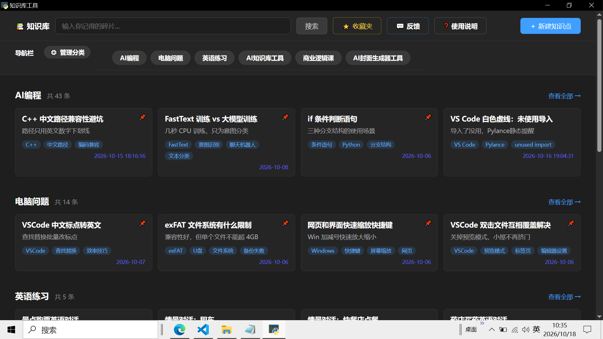
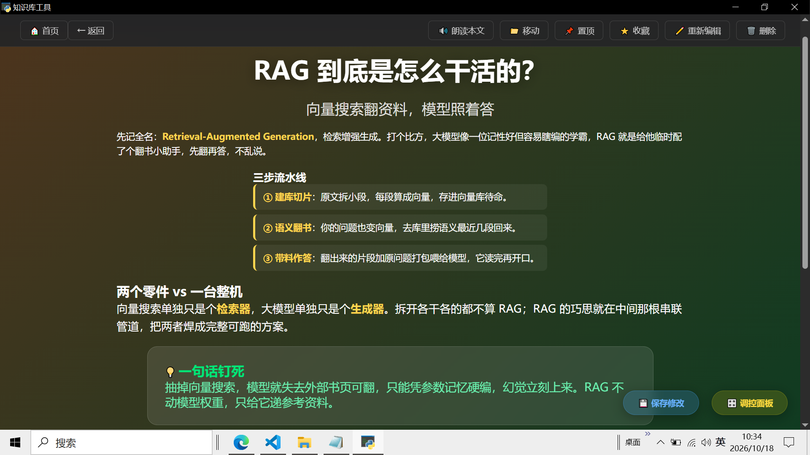
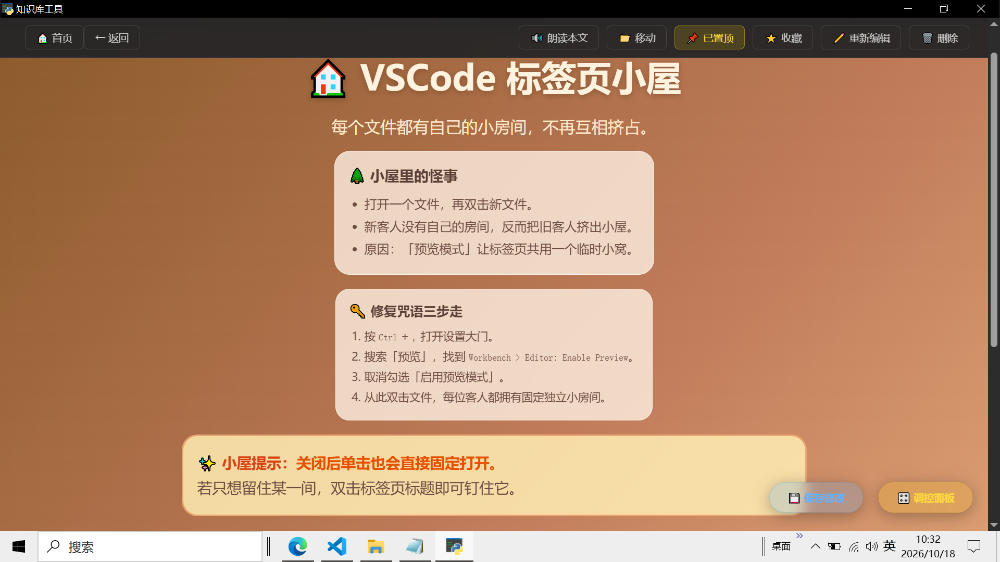

# 📚 AI 知识库工具 (AI Knowledge Tool)


**以学习为核心，用 AI 生成独一无二的知识页面，让复习不再枯燥。**

本工具最大的特色，是以学习为核心、存储为辅助，让学知识变得有趣、有动力、有探索感。

## 📸 效果展示


*图 1：首页 - 规整的分类卡片墙*



*图 2：知识点详情 - 由 AI 独立设计的专属排版与讲演风格*

## ✨ 核心特色

- 💡 **千人千面，视觉不疲劳**
  工具所有展示页面均由免费 AI 根据提示词独立设计生成。整体视觉风格统一规整，但每一个知识页面都是独一无二的：页面背景、配色方案、重点文字颜色、卡片样式全部差异化呈现。复习时不容易产生视觉疲劳和学习倦怠。
- 🎭 **内容讲演，全方位自定义**
  你可以自由指令 AI 修改视觉效果（如土豪金配色、彩虹色系），也可让 AI 设计不同的讲解风格。包括但不限于：东北方言、川渝方言、童话童趣、太空探索科普等多种演绎形式，让知识讲解不再千篇一律。
- 🔄 **设计过程即是深度复习**
  让 AI 设计页面的过程，本身就是一次梳理知识、深度加工学习内容的过程。
- ⚡ **实用工具集成**
  这是一款单机工具，不需要联网。内置语音播放（本地 TTS 引擎）、关键词模糊检索、内容去重（防止重复录入）、AI 智能分类等能力，兼顾趣味性、观赏性与实用性。

## 🚀 快速开始（普通用户）

1. 前往 [Gitee Releases](https://gitee.com/learning-ai-with-bai-qiang/ai-knowledge-tool/releases) 下载最新版的 `AI知识库工具.zip` 压缩包。
2. 解压到任意文件夹（**请勿直接放在 C 盘系统目录**）。
3. 双击 `AI知识库工具.exe` 即可运行，**无需安装 Python 环境**。
4. 所有数据均保存在软件同级目录下的 `data` 文件夹中，请定期备份此文件夹。

## 📖 如何录入知识？

1. 点击首页右上角的 **“＋ 新建知识点”**，在文案区输入你的学习笔记。
2. 点击 **“拼接提示词”**，将拼接好的内容复制给免费 AI（推荐 DeepSeek、元宝、Kimi）。
3. AI 会返回一段代码配置。复制这段配置，回到工具点击 **“导入配置”**。
4. 瞬间生成独一无二的知识点页面，并自动完成分类。点击页面顶部的 **“移动”** 按钮，可以查看或修改分类。

## 🛠️ 从源码运行（开发者）

如果你想二次开发或自行打包，请按照以下步骤：

**环境要求**：Windows 10 / 11，Python 3.10+

```bash
# 1. 克隆仓库
git clone https://gitee.com/learning-ai-with-bai-qiang/ai-knowledge-tool.git
cd ai-knowledge-tool

# 2. 创建并激活虚拟环境
python -m venv venv
venv\Scripts\activate

# 3. 安装依赖
pip install -r requirements.txt

# 4. 运行程序
python app.py
```

**如何打包成 exe？**

本项目提供了 `build.py` 一键打包脚本。在虚拟环境中运行：

```bash
python build.py
```

打包完成后，产物在 `dist/AI知识库工具` 目录下。

## ❓ 常见问题

- **点击朗读没有声音？**
  请检查 Windows 设置中是否安装了“中文（简体）”语音包（设置 -> 时间和语言 -> 语音）。修改知识点并保存后，系统会自动清除旧缓存并重新生成。
- **数据会上传到云端吗？**
  绝对不会。本工具完全离线运行，所有数据均在本地 `data` 文件夹中。
- **分类顺序为什么变了？**
  分类按照创建时间先后排列。编辑知识点不会影响其分类的创建时间。

## 🤝 反馈与支持

如果你在使用中遇到问题，或者有更好的建议，欢迎提交 Issues。
👉 [点击这里提交反馈](https://gitee.com/learning-ai-with-bai-qiang/ai-knowledge-tool/issues)

## 📄 开源协议

本项目基于 [MIT License](LICENSE) 协议开源。你可以自由使用、修改和分发，但请保留原作者信息。